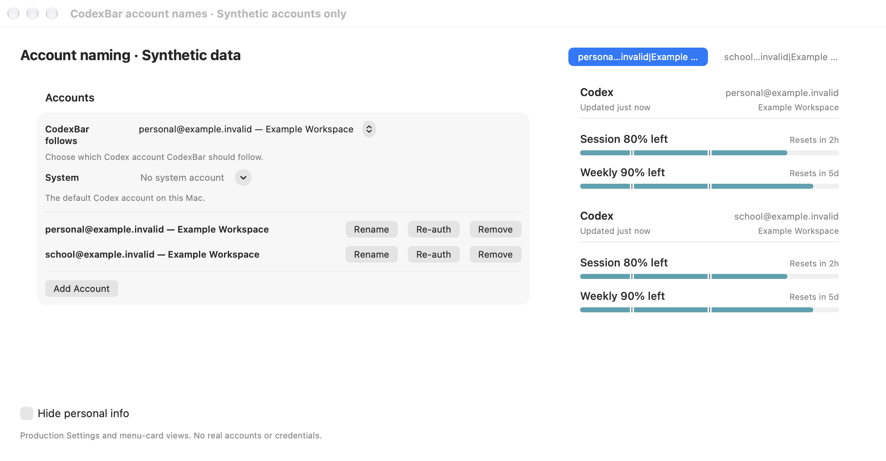
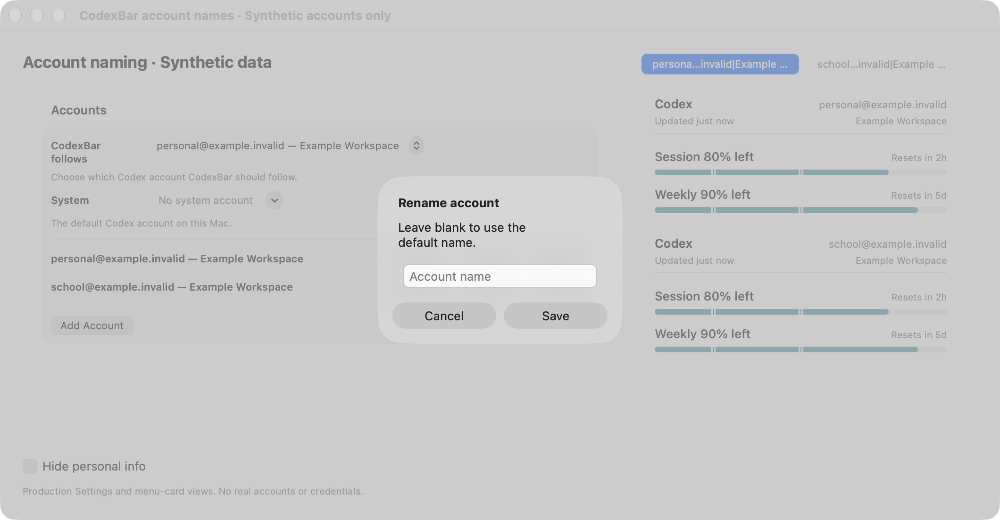
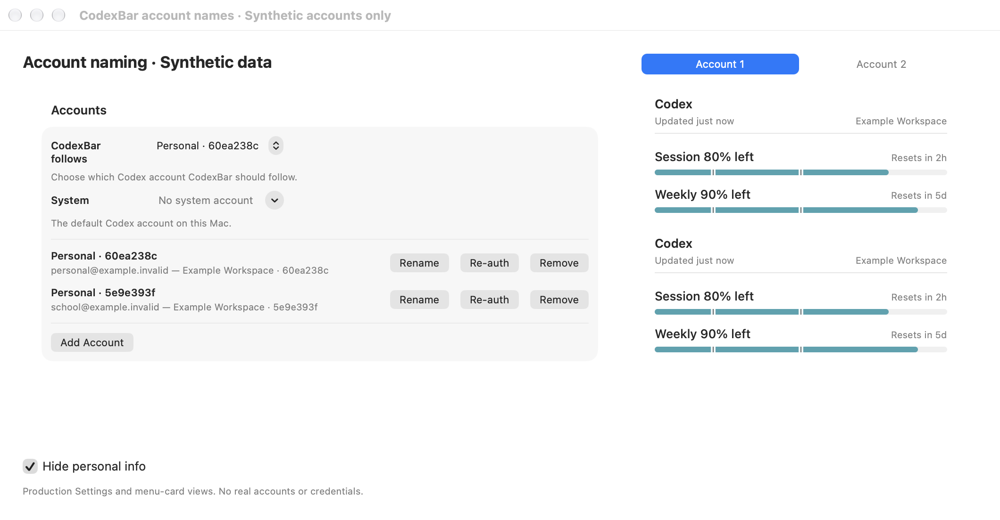
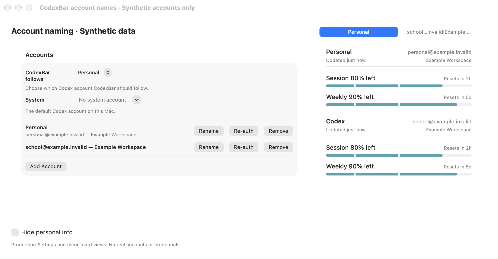
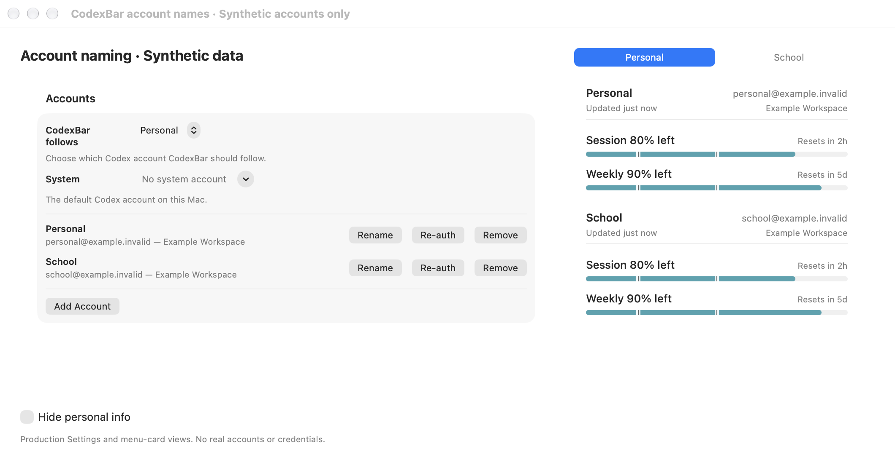

# Codex account naming proof

The opt-in `CodexAccountNamesNativeProofTests` host uses the production Settings account section,
account switcher, menu cards, and configuration persistence. It starts with synthetic version-1
provider configuration and version-3 managed-account metadata. All identities use `example.invalid`.
No credential files, real accounts, provider requests, or installed app settings are used.

The driver presses the actual Rename and Save controls, edits the alert's text field, toggles privacy,
and starts a second test process against the saved configuration. The default captures contain only
the host's rendered view pixels. For compositor-complete captures, set
`CODEXBAR_ACCOUNT_NAMES_PROOF_CAPTURE_WINDOWS=1`. That mode captures only the host window or its own
Rename alert, checks for existing Screen Recording permission, and fails rather than requesting permission.
Neither mode captures the desktop or another application's window.

This is native component-level interaction proof, rather than an installation of a custom app over
an existing app. It does not exercise live login, provider fetches, or full app startup migration.

## Reproduce

Use the repository's test environment and a Python version supported by its process-containment runner.
The output directory contains synthetic fixture data and should remain local.

```sh
CODEXBAR_ACCOUNT_NAMES_PROOF_DIR="$PWD/.build/account-names-proof" \
  ./Scripts/test_fast.sh --filter CodexAccountNamesNativeProofTests
CODEXBAR_ACCOUNT_NAMES_PROOF_DIR="$PWD/.build/account-names-proof" \
CODEXBAR_ACCOUNT_NAMES_PROOF_RELAUNCH=1 \
  ./Scripts/test_fast.sh --skip-build --filter CodexAccountNamesNativeProofTests
```

The two receipts record separate process IDs. Only screenshots and a summarized result should be
published. Do not publish a real configuration, account registry, authentication file, or raw build log.

## Results

- `make check` passed; final proof-driver formatting and lint checks passed.
- 39 focused tests passed across naming, settings, plugin presentation, and plugin refresh.
- The ad-hoc-signed native interaction run and separate-process relaunch run passed.
  Five Save callbacks persisted Personal and School; the second process restored both names.
- Official CodexBar 0.81.0 accepted the synthetic configuration before and after naming.
  Compatibility tests loaded version-1 settings and version-3 account metadata without migration.
- Captures and metadata were reviewed. Only synthetic windows are published; metadata contains
  dimensions, resolution, and the generic Screenshot comment. No raw account files or logs are included.

The local Swift 6.2.4 build needed an explicitly typed array in the existing plugin fingerprint
expression. Its output is unchanged, with existing plugin tests passing.

## Captures

Settings retains the synthetic identity needed to manage each account. Privacy conceals the menu
headings and switcher labels.

### Existing data



### Rename alert



### Saved names


### Duplicate names


### Privacy enabled



### Cleared name



### Separate-process relaunch


